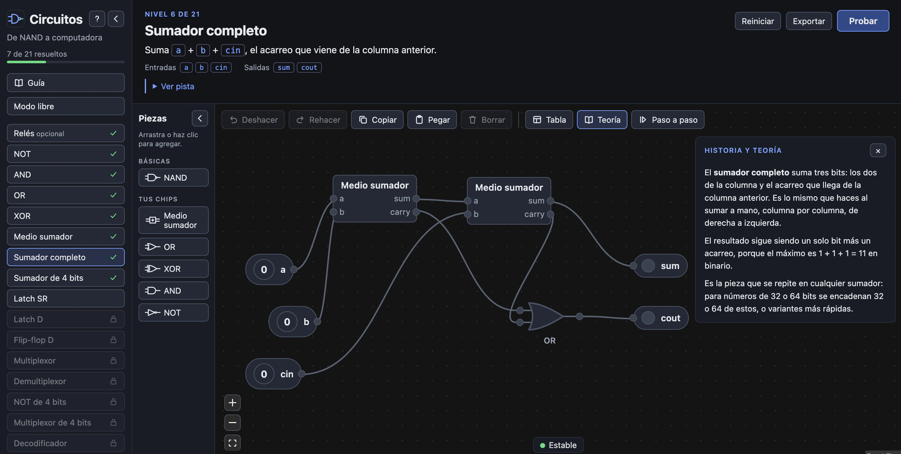
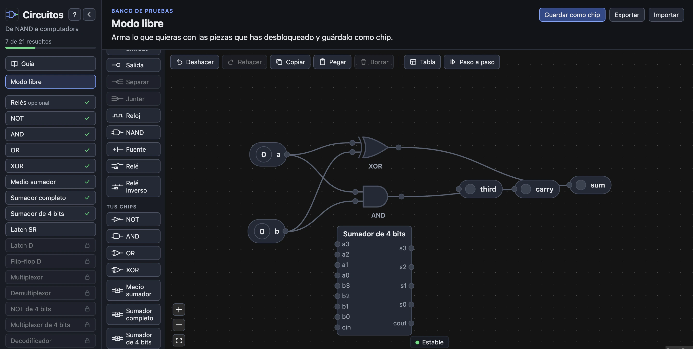
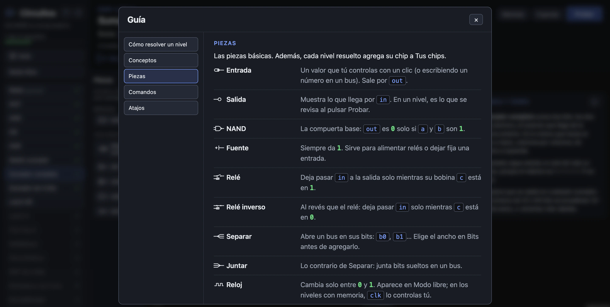
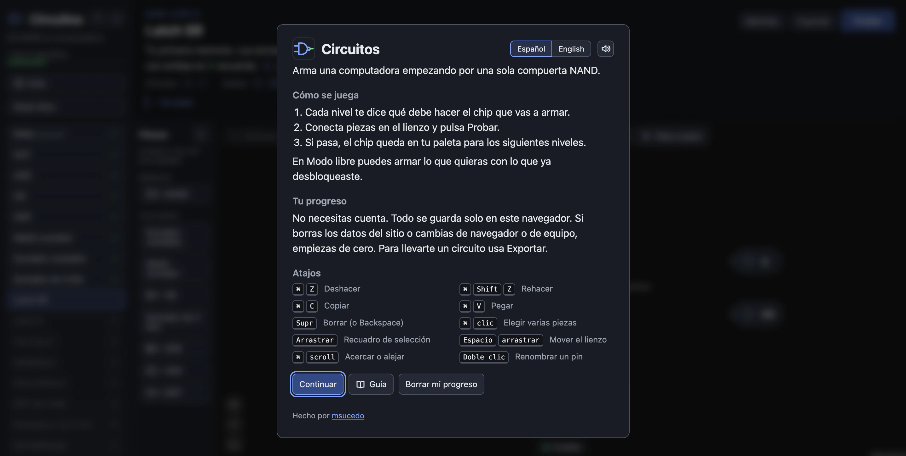

# Circuitos

Arma una computadora desde una compuerta NAND. Cada nivel resuelto se vuelve un chip que puedes usar en los siguientes.



```
npm install
npm run dev        # app en http://localhost:5173
npm test           # tests (motor, schema, editor, niveles, guardado)
npm run sim:demo   # tablas de verdad en la terminal
npm run sim:verify -- examples/xor.json XOR
npm run e2e        # pruebas en Chrome real contra el build (con CSP); capturas en test-results/shots
```

Nivel 0 (opcional): armar la NAND con relés (Fuente, Relé, Relé inverso). Esas piezas se definen en NAND dentro de `src/sim/builtins.ts`, así que el simulador solo corre NAND.

Niveles: compuertas (NOT a XOR), sumadores, memoria (latches y flip-flop D) y el camino a la CPU: multiplexor, demultiplexor, buses de 4 bits (NOT4, MUX4), decodificador, incrementador, una ALU de 4 bits (suma, resta, AND, OR y bandera zero), y memoria con reloj: bit, registro, contador y una RAM de 4 palabras. Los niveles con muchas combinaciones se prueban con casos escogidos (`vectorSpec`), y los de memoria con un modelo de lo que deben recordar (`sequentialSpec`), los dos en `src/sim/verify.ts`.

- `src/sim/`: motor puro (sin DOM): `simulate`, `flatten` (chips anidados), `verify`, `schema` (validación de todo JSON externo).
- `src/editor/`: editor con React Flow.
- `e2e/`: pruebas de UI con Playwright (usa el Google Chrome instalado).
- `src/levels/`: niveles y lo que prueba cada uno.
- `src/storage.ts`, `src/project.ts`: progreso en localStorage, exportar e importar.
- `src/locales/`: textos en español e inglés (i18next); el idioma sale del navegador o del selector de la bienvenida.
- `src/sound.ts`: efectos de sonido generados con Web Audio (sin archivos); se apagan con el botón de la bienvenida.

No hay cuentas: el progreso vive solo en el localStorage del navegador (`circuitos:v1`). La bienvenida sale en cada carga y se reabre con "?". Desde ahí, "Borrar mi progreso" deja una copia en `circuitos:v1:respaldo` antes de empezar de cero.

## Editor

- Buses de 1 a 16 bits: elige "Bits" en la paleta antes de agregar Entrada, Salida, Separar o Juntar. Un cable solo conecta pines del mismo ancho.
- Borrar: botón en la barra o Supr/Backspace (los pines del nivel no se borran). Los atajos están en la ventana "?".
- Ctrl/⌘ + Z deshacer, Ctrl/⌘ + Shift + Z (o Ctrl + Y) rehacer, Ctrl/⌘ + C / V copiar y pegar (también entre niveles).
- Doble clic en el nombre de una entrada o salida (modo libre) para renombrarla.
- "Tabla": tabla de verdad en vivo (hasta 6 bits de entrada); en los niveles pone al lado lo esperado por salida y marca en rojo cada valor incorrecto.
- "Paso a paso": la señal avanza una compuerta por clic con "Avanzar".
- Cada cambio de valor manda un paquete por el cable (se desactiva con "reducir movimiento" del sistema).
- Las compuertas, las piezas básicas, los sumadores y los multiplexores llevan su símbolo en la paleta y en la Guía.
- "Teoría": la historia y la idea de cada nivel, en un panel junto a la tabla. "Ver pista" se despliega debajo del objetivo.
- "Guía": cómo resolver un nivel, conceptos, piezas, comandos y atajos.

## Capturas

Modo libre: arma lo que quieras con los chips que ya desbloqueaste y guárdalo como chip.



Guía: piezas, conceptos y comandos, cada uno con su icono.



Bienvenida: cómo se juega, el idioma, el sonido y los atajos.


